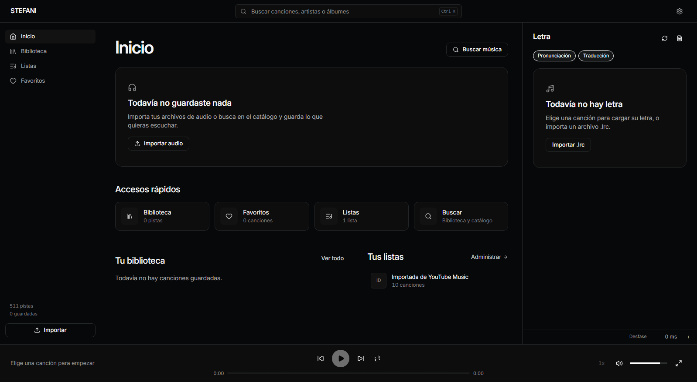
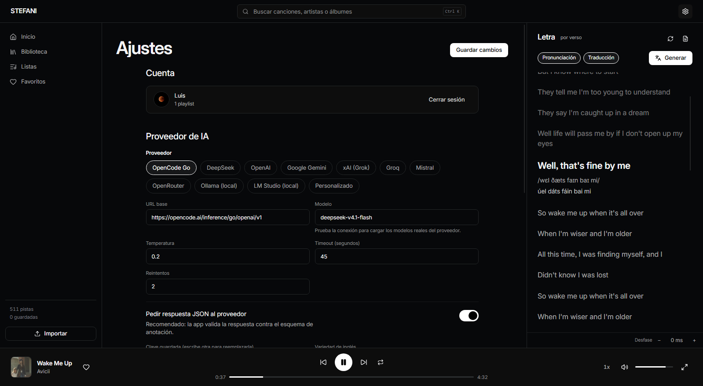
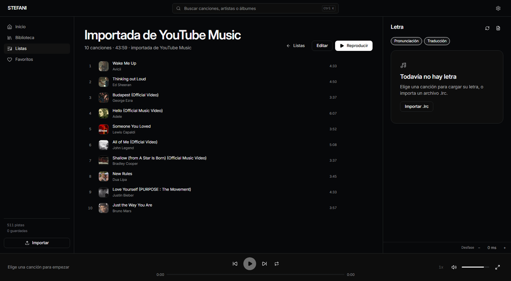
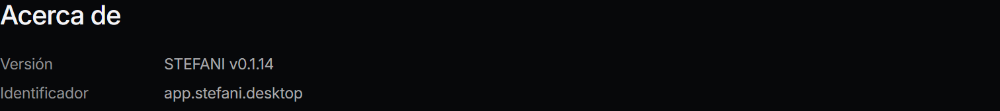

# STEFANI

[](https://github.com/LuiisDev21/stefani/actions/workflows/release.yml)
[](https://github.com/LuiisDev21/stefani/actions/workflows/ci.yml)

A desktop music player built around the lyrics. STEFANI plays local files and
YouTube Music, follows the words in time with the audio, and shows how every
line sounds: IPA transcription, a Spanish-friendly approximation and, when a
provider is configured, a contextual translation with notes on the hard sounds.

Windows is the tested platform. The release workflow also builds Linux and
macOS (Apple silicon) artifacts.

<p align="center">
  
  
</p>
<p align="center">
  
  
</p>

## Features

- **Local playback.** Imports mp3, m4a, aac, wav, flac, ogg and opus. Files are
  referenced in place; nothing is copied into the library.
- **Synchronized lyrics.** LRC, enhanced LRC with word timings and plain text.
  Auto-scroll yields as soon as you scroll manually.
- **Phonetic reading with no setup.** US IPA and a Spanish approximation for any
  lyric, generated locally from the CMU dictionary. No API key required.
- **AI translation.** With a provider configured, the Generate button adds a
  contextual translation and short notes on difficult sounds.
- **Playback speed.** 0.75x, 1x and 1.25x.
- **YouTube Music.** Search and play the catalogue through `yt-dlp` with the same
  lyrics panel. Unofficial integration, enabled by default, disabled by itself
  when the tool is missing.
- **Library, favorites and playlists.** Local lists plus import of YouTube Music
  playlists from a connected Google account.
- **Immersive mode.** Full-screen lyrics with the current line highlighted.
- **AI settings.** Any OpenAI-compatible Chat Completions endpoint. The key lives
  in the OS credential store, never in the database or the logs.
- **Updates.** Settings checks the latest public release, shows the version it is
  running and can download and launch the installer.

## Install

Download the artifact for your platform from the
[latest release](https://github.com/LuiisDev21/stefani/releases/latest):

| Platform | Asset |
| --- | --- |
| Windows | `stefani-windows-amd64.zip` (portable build and NSIS installer) |
| Linux | `stefani-linux-amd64.tar.gz` |
| macOS (Apple silicon) | `stefani-macos-arm64.zip` |

The Windows installer bundles `yt-dlp`, so online playback works on first launch.
After installing, **Settings → Acerca de** keeps the app up to date: it checks the
latest release and, when there is a newer one, downloads the installer and asks
Windows for elevation.

## Build from source

Requirements:

- Go 1.26 or newer (tested with 1.27.1)
- Node 22 or newer and pnpm 11
- Wails CLI v3: `go install github.com/wailsapp/wails/v3/cmd/wails3@v3.1.0`
- Windows: WebView2 (included in Windows 11) and a C compiler for cgo
- Linux: `libgtk-3-dev`, `libgtk-4-dev`, `libwebkit2gtk-4.1-dev` and
  `libwebkitgtk-6.0-dev`
- macOS: Xcode Command Line Tools

```bash
# 1. frontend dependencies
cd frontend && pnpm install && cd ..

# 2. Go to TypeScript bindings (after changing the service API)
wails3 generate bindings -ts

# 3. development with hot reload
wails3 dev

# 4. desktop build
go build -o bin/stefani.exe .    # Windows
go build -o bin/stefani .        # Linux / macOS
```

`wails3 build` packages the native app and, on Windows, the NSIS installer.

### Frontend in a browser

The desktop binary opens no ports. To inspect the UI from Chrome or Edge, run the
server build, which serves the whole app over HTTP with the same database:

```powershell
.\scripts\serve-web.ps1 -Rebuild
```

It listens on <http://127.0.0.1:8080>. `-Lan` exposes it on the local network
(`STEFANI_WEB_HOST=0.0.0.0`); there is no authentication, so use it only on a
trusted network.

## How it works

- **Go** owns playback state, the library, SQLite storage, the lyrics pipeline
  (LRC parsing, LRCLIB, CMUdict phonetics) and the `yt-dlp` integration.
- **React 19 + Vite** render the UI. The player clock is the single source of
  truth: the lyric view derives the active line, the active word and the fill
  progress from a timestamp and never keeps its own timer.
- **Wails 3** hosts the WebView2 window and exposes the service as typed
  TypeScript bindings.
- Online audio is streamed through a Range proxy in front of `yt-dlp`, so seeking
  works like a local file. It needs `yt-dlp` and `ffmpeg`; the app looks for both
  in `PATH` and in the usual Windows folders, so it also works when launched from
  Explorer.

## Tests

```bash
go test ./internal/... -count=1      # domain, storage, lyrics, AI
go vet ./...

cd frontend
pnpm exec tsc --noEmit
pnpm test
pnpm exec playwright test            # E2E against the real Go server
```

The E2E harness builds the app with `-tags server` and drives it with Playwright
against `http://127.0.0.1:8080` using a temporary `STEFANI_HOME`, so it never
touches the real profile. Coverage and details live in
[docs/TESTING.md](docs/TESTING.md).

## Data and privacy

- Everything is stored in the user configuration directory:
  `%APPDATA%\stefani` on Windows, `~/.config/stefani` on Linux and macOS.
- The database is SQLite at `data/stefani.db`.
- The AI API key is kept in the system credential store, never in the database,
  the config file or the logs.
- The Google session used to read playlists lives in the app's WebView2 profile;
  it is never copied to the database, the config file or the logs.
- Lyrics fetched from LRCLIB are cached locally for private use.
- No telemetry and no accounts of our own.

## Limitations

- **YouTube Music catalogue tracks.** Search and playlist import use the public
  web client (InnerTube). Tracks without a playable stream are opened in the
  official page instead of playing in-app; the experimental catalogue must be
  enabled in Settings.
- **eSpeak NG is not bundled.** Its GPL license complicates binary distribution.
  The Spanish approximation is computed locally with CMUdict; IPA for a new song
  comes from the configured AI provider.
- **Word alignment.** When a lyric only has line timings, the app says so and
  never invents word timings.
- **Speed and seeking** depend on the HTML5 audio engine; sources that do not
  support them (the YouTube catalogue) disable those controls.
- **Unsigned builds.** The installers are not code-signed or notarized.

## Documentation

- [Architecture](docs/ARCHITECTURE.md)
- [Design system](docs/DESIGN_SYSTEM.md)
- [Providers](docs/PROVIDERS.md)
- [Testing](docs/TESTING.md)
- [Security](docs/SECURITY.md)
- [Licenses](docs/LICENSES.md)
- [Decisions](docs/DECISIONS.md)
- [Roadmap](docs/ROADMAP.md)

The product name, identifier and branding live in `internal/brand/brand.go` and
`build/config.yml`; renaming the product does not require touching the
architecture.
